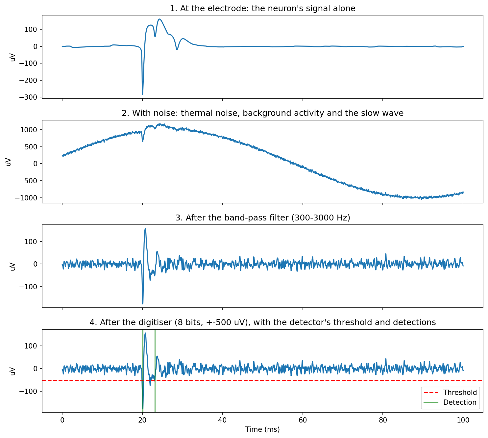
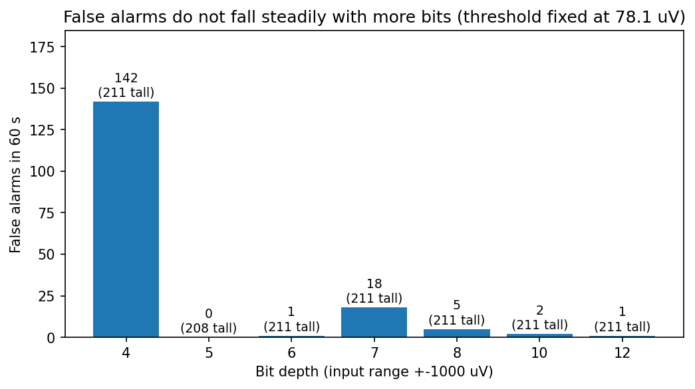
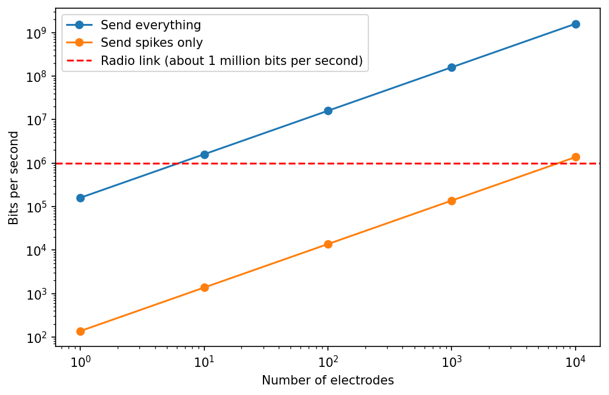
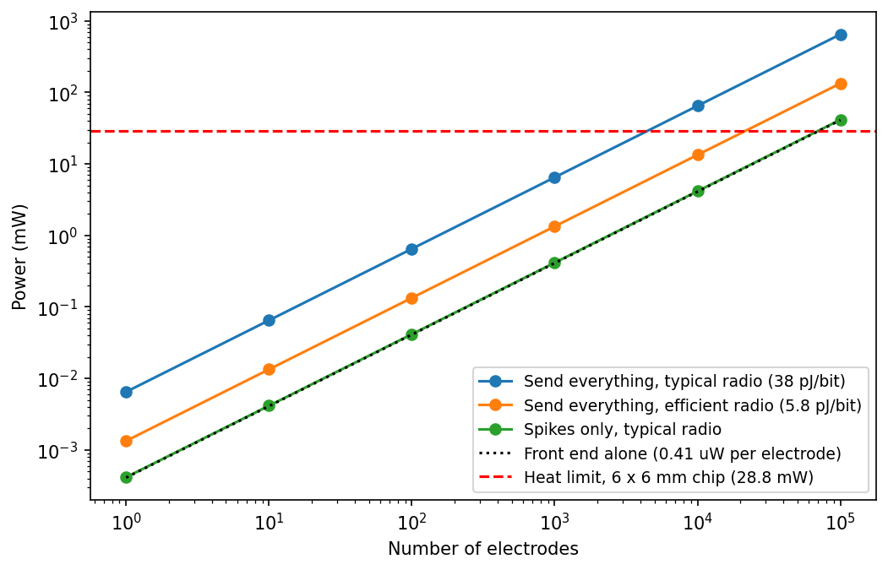
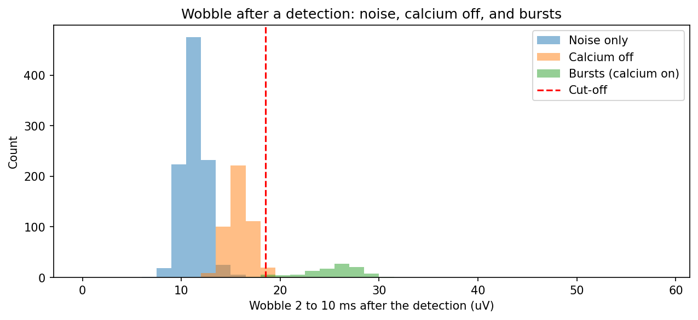
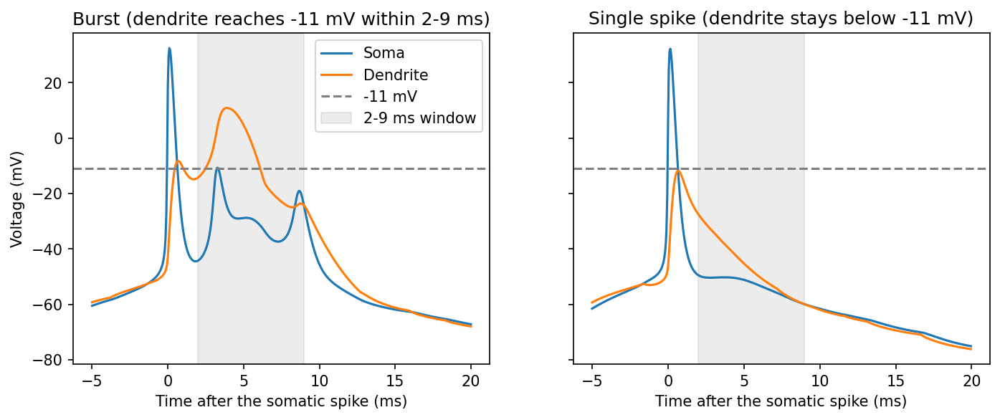

# Neural Recording Chain

Simulating the path from neuron to bits: how electrode noise, filtering, ADC and
on-chip spike detection choices affect what a brain-computer interface can read.

**Status:** work in progress. The spike source, recording chain, data-rate calculation and burst label are done. The whole-number spike detector is done too (the filter stays in floating point). A power budget and real recordings are still to do.

## What this project does

A brain-computer interface never sees a neuron directly. Between the cell and
the data sits a chain of hardware, and every stage loses something:

```
neuron -> electrode -> noise -> filter -> ADC -> spike detection -> data link
```

This project models each stage in Python and measures how its settings change
one concrete outcome: can the spikes still be detected?



*100 ms of recording A around a burst: the neuron's signal at the electrode, with noise added, after the band-pass filter, and after the digitiser with the detector's threshold (red) and detections (green). The slow wave dominates the raw signal and is removed by the filter. Here the burst's first spike and one of its later, smaller spikes are detected; across the whole recording most small spikes inside bursts stay above the threshold and are missed.*

## Roadmap

| Phase | What | Status |
|---|---|---|
| 0 | Project setup | done |
| 1 | Spike source: input, neuron, true spike times, electrode signal | done |
| 2 | Recording chain: noise, filter, digitiser, spike detector, scoring | done |
| 3 | Data rate at 100, 1,000 and 10,000 channels | done |
| 3b | Power budget | done (radio and front end; spike detection itself not included) |
| 3c | Burst or single-spike label from the detector's own detections | done |
| 4 | Spike detection with whole-number arithmetic, as on a chip | done (detector only; the filter stays in floating point) |
| 5 | Validation on real recordings | planned |
| 6 | Write-up | planned |

## Spike source

The ground-truth spikes come from my hippocampal microcircuit model
(a Pinsky-Rinzel pyramidal cell and a Wang-Buzsaki interneuron). Only the pyramidal cell is used in this project:
<https://github.com/Parineeta98/Hippocampal-Microcircuit-Model-of-Pyramidal-Cell-and-Interneuron>

The model is driven by the frozen noise protocol of Zeldenrust et al. (2017).

## Research questions

The questions below were refined during the work, not fixed in advance.

1. **Detection.** How do the choices in a recording chain (filtering, bit depth, input range, detection threshold and dead time) affect whether spikes from a single simulated neuron can still be detected? The electrode noise level was kept fixed.
2. **Data budget.** How much less data does a chip need to send if it detects spikes on the chip instead of sending the raw signal, and how many electrodes would then fit through a wireless link of about 1 Mbps?
3. **Bursts versus single spikes.** Can a chip that only sees the extracellular signal tell bursts from single spikes, and does this still work on a recording with a new input and on one with a much higher firing rate?

## Expectations and status

- **H1.** Detection gets worse as bit depth falls, with a minimum bit depth below which it breaks down. *Status: retested with the threshold fixed before the digitiser (notebook 03). Every tall spike was found from 6 bits upwards (±1000 µV range). False alarms do not fall steadily with more bits (4 bits: 142, 5: 0 with 3 tall spikes missed, 6: 1, 7: 18, 8: 5, 10: 2), because rounding to the digitiser's steps moves the effective threshold by up to half a step. A design should check the threshold against the step size, not only choose enough bits. The earlier "7 to 8 bits" result is withdrawn: the threshold was then measured on the digitised signal and collapsed with it. These runs use the signal before the filter and without the slow wave, so they test the digitiser alone.*
- **H2.** Sending only detected spikes reduces the data rate by about three orders of magnitude. *Status: supported in this simulation (about 1,163 times smaller), but it depends on the firing rate and on an assumed 32 bits per spike.*
- **H3.** Bursts leave a longer-lasting signal after the first detection (the "wobble") than single spikes do, because of the dendritic calcium spike. *Status: supported by a control (see below). The difference is there (median 26 uV versus 16 uV on recording A) and it needs the calcium current, but the control cannot separate the dendritic current itself from the extra spikes it causes.*
- **Question 3, outcome.** On recording B (same input level) the burst label reaches a balanced accuracy of 91.7% (only 26 single spikes, so this number is uncertain). On recording C (about four times more spikes) it drops to 79.9%: all 414 caught bursts are labelled correctly, but only 405 of 677 caught single spikes are (683 true singles; 6 were never detected). Of the 272 wrong singles, 257 sat in a group of two or more detections, and in 253 of these the group also held another true event; only 15 were wrong because of the wobble cut-off. The rule "two or more detections = burst" therefore only works when events are well spaced. This is a limitation of the method and is not fixed here.



*H1: false alarms at each bit depth with the threshold fixed before the digitiser (numbers in brackets: tall spikes found, of 211). Rounding to the digitiser's steps moves the effective threshold, so false alarms do not fall steadily with more bits.*



*H2: data rate against the number of electrodes when the chip sends every sample (8 bits, 20 kHz) or only the detected spikes (32 bits each), compared with a radio link of about 1 Mbps.*

## Detection results

All chain settings (4.5 times the noise, 3 ms dead time, 8 bits, ±500 µV) were chosen on recording A and then run unchanged on B and C (notebook 03). Spike-level key, ±1 ms.

| | A (tuning) | B (test) | C (test, stronger input) |
|---|---|---|---|
| Tall spikes found | 209 / 211 (99.1%) | 164 / 164 (100%) | 1,090 / 1,099 (99.2%) |
| Small spikes found | 43 / 331 (13%) | 38 / 291 (13%) | 250 / 964 (26%) |
| False alarms in 60 s | 6 | 4 | 11 |

The small spikes inside bursts are mostly missed on all three recordings. Two settings cause this: the threshold (they are smaller than it) and the 3 ms dead time. On recording A, a 1 ms dead time finds 72 of 331 small spikes but with 164 false alarms, against 43 with 6 false alarms at 3 ms (notebook 03). B and C use a new input and new noise, but the same neuron, electrode model and noise model.

## Chip detector (whole numbers)

The whole-number detector (see Methods) was run on the same signal as the floating-point detector: 8 bits, ±500 µV, and only the samples after the first 1.6 s, while the chip's average settles (notebook 07). Spike-level key, ±1 ms.

**Recordings A and B: the chip detector matches the floating-point detector.**

| | Tall spikes | Small spikes | False alarms |
|---|---|---|---|
| A, floating-point | 201 / 203 | 41 / 319 | 6 |
| A, chip | 201 / 203 | 38 / 319 | 7 |
| B, floating-point | 160 / 160 | 38 / 283 | 4 |
| B, chip | 160 / 160 | 38 / 283 | 5 |

The chip finds the same tall spikes, and the small spikes and false alarms differ by at most 3. A detector built from whole numbers, additions, shifts and one multiplication by a constant, with a few stored numbers (57 bits per electrode) instead of the whole recording, does as well as the floating-point version on these two recordings.

**Recording C: the chip detector is stricter.**

| | Tall spikes | Small spikes | False alarms |
|---|---|---|---|
| C, floating-point | 1,062 / 1,071 | 241 / 934 | 11 |
| C, chip | 1,059 / 1,071 | 167 / 934 | 2 |

On recording C, with about four times the firing rate, the chip found 3 fewer tall spikes and 74 fewer small spikes, with 9 fewer false alarms. That is the pattern of a higher threshold, and the thresholds show it (notebook 07). The floating-point threshold is 52.1 µV, which is 13.3 codes (one code is 3.9 µV). The chip's threshold changes over time, so its typical value (median) and range over the recording are given:

| | Floating-point threshold | Chip threshold, typical | Chip range |
|---|---|---|---|
| A | 13.3 codes | 13 | 12 to 14 |
| B | 13.3 codes | 13 | 12 to 14 |
| C | 13.3 codes | 14 | 13 to 15 |

On A and B the two thresholds are effectively the same: for whole numbers, "a code below −13.3" is the same as "a code below −13", which is the chip's typical value. It only moves by one code now and then, which fits the small differences of up to 3 spikes. On C the chip's threshold is typically one code higher, while the median-based one stays at 13.3 even with four times as many spikes. This fits the explanation that frequent spikes push the running average up but not the median. Oprea et al. (2022) found the median more robust and the average cheaper, but did not look at firing rate, so this explanation is our own. The pause after a detection keeps the samples after a spike out of the average, but not the samples just before it (the way down into the dip) and not the small spikes that were never detected; with four times as many spikes these add up. This mechanism was not tested separately: the thresholds show that the chip's is higher on C, not why. One code (3.9 µV) was enough to change 74 small-spike detections, because many small spikes lie close to the threshold. The tall spikes are far above it and are barely affected (3 fewer).

The counts here differ from the table under "Detection results" because the first 1.6 s are left out (203 tall and 319 small spikes on A instead of 211 and 331), and because both detectors here work on the digitised signal.

### Memory

Per electrode, the chip detector stores 57 bits: the running average (27 bits), the last three codes for the lowest-point check (24 bits) and the dead-time counter (6 bits), plus one 16-bit settling counter shared by all electrodes (notebook 07 calculates the first three). A median over only the last second would need every sample of that second, 160,000 bits per electrode (2,807 times more), and a median over a 60 s recording 9.6 million bits (about 170,000 times more).

| Electrodes | Chip detector | Median over the last second |
|---|---|---|
| 100 | 0.7 kB | 2 MB |
| 1,000 | 7.1 kB | 20 MB |
| 10,000 | 71 kB | 200 MB |

These figures cover only what each detector has to remember, not the digitiser, the filter, sending the data or the rest of the chip. A real sliding median would also need extra bookkeeping to stay sorted, so 160,000 bits is the minimum for it. These ratios are against an exact median. Approximations need far less: Oprea et al. (2022) estimate the median from 25 samples, and Burman et al. (2024) describe a median estimator that needs no stored samples, so the saving over a practical median is much smaller. The memory available on real implant chips was not looked up.

## Power budget

The power of the radio and the front end was added up for 1 to 100,000 electrodes and compared with the heat limit of a 6 x 6 mm chip, 28.8 mW (notebook 08; sources and assumptions under Methods). The spike rate is the 4.3 detections per second on recording A, and the bit rates are those of the data budget (8 bits at 20 kHz, or 32 bits per spike).

| Case | Power per electrode | Electrodes under the heat limit |
|---|---|---|
| Send everything, typical radio (38 pJ/bit) | 6.49 uW | 4,437 |
| Send everything, efficient radio (5.8 pJ/bit) | 1.34 uW | 21,524 |
| Spikes only, typical radio | 0.415 uW | 69,359 |
| Spikes only, efficient radio | 0.411 uW | 70,107 |



*Total power (front end plus radio) against the number of electrodes. The dotted line is the front end alone; the red dashed line is the heat limit of a 6 x 6 mm chip.*

Sending only spikes cuts the radio's power by about 1,000 times, after which the radio is almost free and the front end (0.41 uW per electrode) is nearly all of the remaining power. Sending everything with the typical radio crosses the heat limit at about 4,400 electrodes, and with the efficient radio at about 21,500.

Under these numbers, heat is not the tightest limit. The data budget showed that a link of about 1 Mbps carries everything from only 6 electrodes, or spikes from up to about 7,300, far fewer than the heat limit allows in either case. So for a link of that size, spike detection is needed mainly to fit the data through the link, and only at larger electrode counts or with a less efficient radio also to stay under the heat limit. Three things make the power figures optimistic: the energy per bit is each transmitter's own best value, without the extra energy to reach a receiver further away; spike detection and the rest of the chip are not counted; and the front end is one 22 nm chip's figure, not a model of this chain.

## Control: calcium switched off

As a control, recording A's input was simulated with the dendritic calcium conductance set to zero. This produced no bursts (466 single spikes). The wobble after detection, for the 463 events the detector saw as one detection, had a median of 15.9 uV. That matches normal single spikes (16.2 uV) and sits above the noise floor (11.3 uV), which reflects the spike tail and filter ringing that every spike has. Only bursts with the calcium current on reached the higher level (25.8 uV), and 8 of the 463 calcium-off events (1.7%) crossed the burst cut-off. The burst wobble therefore depends on the calcium current, though this control cannot separate the dendritic current itself from the extra small spikes it causes.

| Situation | Typical wobble |
|---|---|
| Noise only (no spike) | 11.3 uV |
| Single spike, calcium off | 15.9 uV |
| Single spike, normal neuron | 16.2 uV |
| Burst, normal neuron | 25.8 uV |



*H3: the wobble 2 to 10 ms after a detection, for noise-only windows, events with the calcium current switched off, and bursts with it on. The dashed line is the burst cut-off chosen on recording A.*

## Step-size check

The first 10 s of recording A's input were simulated with the 0.05 ms step used everywhere and with a 0.025 ms step (same input, each value repeated twice; notebook 02).

| | 0.05 ms | 0.025 ms |
|---|---|---|
| Spikes | 97 | 96 |
| Events | 37 | 35 |
| Bursts | 29 | 28 |
| Single spikes | 8 | 7 |
| First event times (ms) | 65.45, 339.50, 508.25, 544.95, 882.25 | 65.38, 339.42, 508.18, 544.83, 882.12 |

Event times shifted by about 0.1 ms (0.07 to 0.13 ms), well within the 1 ms scoring tolerance. The counts differ by 1 spike and 2 events (the share of bursts is 78% against 80%). The 0.05 ms step was kept. Exact counts can shift by a few percent with the step size, so they are not converged, which fits the note that counts also differ slightly between computers. The check covers the neuron simulation only, over 10 s; the chain results were not re-run with the smaller step.

## Methods

**Neuron model.** A two-compartment Pinsky-Rinzel pyramidal cell (soma and dendrite; Pinsky & Rinzel, 1994; Rinzel & Pinsky, 1995), simulated in Brian2 (Euler method, 0.05 ms step). The calcium gate constants (53.3) follow Zeldenrust and Wadman (2013), Appendix A.1. Interneurons are not included.

**Input.** Frozen noise following Zeldenrust et al. (2017): a hidden on/off state (time constant 50 ms) driving 1,000 artificial input neurons, filtered with a 5 ms kernel. The input is regenerated with fixed seeds, not loaded from the thesis files. Settings: scale 20 uA, baseline -0.4 uA (the code uses uA; the model's parameters are Pinsky and Rinzel's per-area values, so this is effectively uA/cm2).

**Recordings** (60 s each).
- **A** (seed 0): used to choose all chain settings (tuning) and the burst-label cut-off. Its results are in-sample.
- **B** (seed 1, same input level): a test recording, never used for tuning.
- **C** (seed 2, baseline 3.0): a test recording with a much higher firing rate (2,063 spikes in 60 s, against 542 on A).

**Answer keys.**
- *Spike level:* every somatic spike, found with a peak finder (above -40 mV, prominence 5 mV). Used to score detection. The count depends on these settings (prominence 2, 5, 10 and 20 mV gave 572, 543, 517 and 449 spikes before the calcium constant was changed to 53.3; with 5 mV the count is now 542); the tall spikes are stable.
- *Event level:* the burst rule from Zeldenrust and Wadman (2013), section 2.4. Each somatic spike crossing 0 mV starts one event. It is a burst if the dendrite reaches -11 mV within 2 to 9 ms afterwards; otherwise it is a single spike. The code tests the highest dendrite voltage in that window, not an upward crossing. On recording A, 30 of the 211 events already had the dendrite above -11 mV when the window opened (their calcium spike started within 2 ms), so a strict crossing rule would call up to 30 bursts singles. In none of the 211 was the dendrite already above -11 mV at the somatic spike itself.
- *Gap rule (what the detector can do on its own):* spikes less than 10 ms apart belong to one event, since the detector cannot see the dendrite.



*The event-level answer key on recording A: in a burst (left) the dendrite reaches -11 mV inside the 2 to 9 ms window after the somatic spike; in a single spike (right) it stays below.*

**Recording chain.**
1. Extracellular potential at the electrode: a two-point-source approximation (soma 50 um, dendrite 200 um away, tissue conductivity 0.3 S/m).
2. Noise: thermal noise (1 MOhm, 310 K, about 13 uV rms), background activity (10 uV rms, 300 to 3000 Hz) and a slow wave (8 Hz, 1000 uV).
3. Band-pass filter: Butterworth, order 2, 300 to 3000 Hz, applied forwards in time as a chip would. The band follows the example in Quian Quiroga (2007); Quian Quiroga et al. (2004) used a wider band (300 to 6000 Hz, four-pole Butterworth). The order is a choice made here.
4. Digitiser: chosen bit depth and input range, with clipping.
5. Detector: a negative threshold at a multiple of the noise level, with a dead time between detections. The noise level is estimated as median(|x|) / 0.6745 (Quian Quiroga et al., 2004). Their threshold is 4 times this noise level; 4.5 was chosen here on recording A.

**Electrode model.** The extracellular potential is computed with the point-source approximation (Ness et al., 2022): the soma and the dendrite are each treated as a single point current source, and their contributions are summed. The current is the coupling current between the two compartments, so the cell acts as a simple two-point source. This assumes the tissue conducts equally well in all directions and everywhere, which normally gives fair estimates in cortical tissue (Ness et al., 2022). The conductivity is set to 0.3 S/m, a commonly used modelling value (for example in the LFPy examples; Lindén et al., 2014), not a value measured for this cell. The electrode distances (50 um from the soma, 200 um from the dendrite) and the membrane area are assumed; they set the spike size at the electrode. Two point sources are a strong simplification of a real neuron's shape.

**Thermal noise.** Electrode thermal noise is modelled as Johnson-Nyquist noise, sqrt(4kTRB) (Johnson, 1928; Nyquist, 1928), with T = 310 K, R = 1 MOhm and B = 10 kHz (half the sampling rate), giving 13.1 uV rms. It is generated as white noise over that whole band, and the 300 to 3000 Hz filter then keeps only part of it. The 1 MOhm is an assumed order of magnitude, not a measured value. In real electrodes only the resistive (real) part of the impedance produces thermal noise (Obien et al., 2015), so treating the full 1 MOhm as a resistor probably overestimates this noise.

**Background activity.** Activity from distant neurons is modelled as band-limited noise (300 to 3000 Hz) of 10 uV rms. This value is assumed, not sourced; how the total noise splits between thermal noise and background activity is a choice made here. After band-pass filtering, the total noise in the simulated recording is about 12 uV (the detector's estimate is 52.1 uV / 4.5 = 11.6 uV). For comparison, noise measured per channel in tetrode recordings from visual cortex had a mean of 21 uV rms (range 12 to 35 uV; Mechler & Victor, 2012), so this simulation is at the quiet end. The spikes are large by comparison: the tall spikes have a median size of 283 uV at the electrode (range 90 to 292 uV) and 179 uV after filtering (range 68 to 184 uV), measured as the deepest dip within 1 ms of each of the 211 tall spikes on recording A without noise (notebook 03), at the assumed 50 um distance, against a measured mean of 91 uV (range 25 to 313 uV) in the same data. Most tall spikes are close to the largest size (median 283 uV, maximum 292 uV), but a few are much smaller, down to 90 uV. The median simulated spike is about three times the measured mean, while the simulated noise is at the quiet end of the measured range. The filter band of those recordings was not checked, so the noise comparison is approximate. Real recordings are often noisier, with smaller spikes, so the detection results here are on the optimistic side. Mains interference (50 Hz) is not modelled.

**Slow wave.** A sine wave of 8 Hz and 1000 uV stands in for hippocampal theta, which in the awake rat lies at about 6 to 9 Hz (Buzsaki, 2002), as a field potential of up to about 2 mV (Bland, 2008). The size and frequency are assumed values. This follows the rodent rhythm. In humans, hippocampal rhythms of 1 to 4 Hz have been reported (Jacobs, 2014), although 7 to 9 Hz has also been seen during real-world and virtual navigation, with the frequency varying between tasks (Bohbot et al., 2017). In this chain the band-pass filter comes before the digitiser, and its gain at 8 Hz is about -65 dB, so a 1000 uV wave leaves less than 1 uV (apart from a start-up transient of about 12 uV in the first 20 ms). Its exact size therefore has little effect on the results here. It would matter for a chip that digitises before filtering: with the wave added, the recording spans -1316 to +1203 uV (notebook 03), more than the +-500 uV input range used.

**Scoring.**
- Detection: each true spike is matched to at most one detection (within 1 ms). Hits, misses and false alarms (detections matching no true spike) are reported. Tall spikes are those that reach above 0 mV in the cell body; small spikes are the rest (mostly later spikes inside a burst).
- Burst label: each true event is counted once, with misses and false alarms reported. Here a false alarm is a detected group of detections that matches no true event, which is a different count from the detection false alarms above. Balanced accuracy is used, because the recordings contain unequal numbers of bursts and single spikes.

**Data budget.** Raw rate = electrodes x sampling rate x bits. Spike rate = electrodes x spikes per second x 32 bits. The spike rate comes from the detections in recording A (about 4.3 per second) and assumes every electrode sits next to a neuron like it. Both are compared with Neuralink's published figures (about 200 Mbps produced, about 1 Mbps wireless; Neuralink). The extra bit for the burst label and the chip's computing cost are not included.

**Power budget.** Everything on an implant turns its power into heat in the tissue, so the power is limited by how much warming the tissue tolerates. Three parts are compared (`data_rate.py`):
- **Radio:** power = bits per second x energy per bit. Two published implant transmitters set the range: 5.8 pJ/bit for an ultra-wideband transmitter designed for intracortical recordings (Song et al., 2022) and 38 pJ/bit for a low-power 2.4 GHz transmitter (Mercier et al., 2014). The bit rates are the raw and spike-only rates from the data budget.
- **Front end:** the amplifier and digitiser on every electrode run all the time, whether spikes are sent or not. 0.41 uW per electrode is used, measured on a 22 nm chip with 9-bit output at 20 kHz (Guo et al., 2024). This is one published chip, not a model of the chain here.
- **Heat limit:** about 80 mW per cm2 of tissue touched by the implant (0.8 mW per mm2), which keeps the warming to about 1 degree C (Kim et al., 2006). Kim et al. take this figure from Seese et al. (1998), whose measurements are from muscle tissue, not brain. A 6 x 6 mm chip, the size Kim et al. modelled, may then use about 28.8 mW.

Not included: the power of spike detection itself, the rest of the chip, and the extra energy a radio needs to reach a receiver further away. The energy-per-bit figures are the transmitters' own, so the radio power here is a lower bound.

**Chip detector (whole numbers).** A second detector (`detect_spikes_on_chip` in `detector.py`) works only with whole numbers, as a chip would. In this README, "chip detector" always means this whole-number detector; everything else (the detection results, the burst label and the data budget) uses the floating-point detector. It takes the digitiser's codes instead of microvolts (8 bits: -128 to +127; one code is 3.9 uV at +-500 uV), counts the dead time in samples (3 ms = 60 samples) and returns sample numbers. The band-pass filter is treated as analogue, before the digitiser, so it stays in floating point. With a given threshold (converted to codes by dropping the decimals), the whole-number rules make the same decisions as the floating-point detector.

The chip cannot cheaply use the exact median: it would need the recent recording stored and sorted (approximations exist, such as the one proposed by Oprea et al., 2022). Instead it keeps a running average of the signal's size, the usual low-cost choice in spike-detection hardware, while the median is more accurate and more robust to the choice of threshold factor, but the exact median is much more expensive to build (Oprea et al., 2022). The average itself is updated with every sample using only additions and bit shifts, as in hardware spike detectors (Harrison, 2003; Zhang & Constandinou, 2021):
- Each sample moves the average 1/8192 of the way towards its own size (a shift by 13 bits), so the average follows roughly the last 8,192 samples (410 ms): much longer than a spike or a burst, much shorter than the slow drift of a real implant.
- The average is stored 64 times larger (6 extra bits), so its fractions are not lost when shifting. Without them, it settled about half a code too high.
- The threshold is 5.64 times the average size (implemented as x 361, then a shift by 6 bits). This is the detector's one multiplication, by a constant; since 361 = 256 + 64 + 32 + 8 + 1, it could also be built from shifts and additions. For Gaussian noise the mean absolute value is 0.798 times the standard deviation, so 5.64 times the average matches the floating-point detector's 4.5 times the noise.
- Following Zhang and Constandinou (2021), the average is not updated during the dead time after a detection, so the spikes themselves pull it up less. Their second rule, leaving out samples above half the threshold, was not used: it lowers the average, and with a factor derived for Gaussian noise it set the threshold too low.
- The average starts at zero, so the detector ignores the first 32,768 samples (1.6 s) while the threshold settles. That is four time constants, after which less than 2% of the starting value remains.

The time constant, the settling period and the factor 5.64 are choices made here, not values taken from a source.

**Assumptions without a source yet:** the background-noise size, the electrode resistance (1 MOhm), the slow-wave size, the membrane area, the electrode distances, the 20 kHz sampling rate, the input units, the 32 bits per spike, and the chain settings chosen on recording A (4.5 times the noise, 3 ms dead time, 8 bits, +-500 uV). Spike counts can also differ slightly between computers.

## What this project does not model

An amplifier, a real electrode's impedance, a surface (ECoG) electrode, more than one neuron, real recorded data, a whole-number (fixed-point) filter, the power of the front end (taken from one published chip) or of spike detection itself, or any specific company's device.

## References

- Bland, B. H. (2008). Anatomical, physiological, and pharmacological properties underlying hippocampal sensorimotor integration. In C. Holscher & M. Munk (Eds.), *Information Processing by Neuronal Populations* (pp. 283-325). Cambridge University Press.
- Bohbot, V. D., Copara, M. S., Gotman, J., & Ekstrom, A. D. (2017). Low-frequency theta oscillations in the human hippocampus during real-world and virtual navigation. *Nature Communications*, 8, 14415. <https://doi.org/10.1038/ncomms14415>
- Burman, A., Solé-Casals, J., & Lew, S. E. (2024). Robust and memory-less median estimation for real-time spike detection. *PLOS ONE*, 19(11), e0308125. <https://doi.org/10.1371/journal.pone.0308125>
- Buzsaki, G. (2002). Theta oscillations in the hippocampus. *Neuron*, 33(3), 325-340. <https://doi.org/10.1016/S0896-6273(02)00586-X>
- Guo, L., Weiße, A., Zeinolabedin, S. M. A., Schüffny, F. M., Stolba, M., Ma, Q., Wang, Z., Scholze, S., Dixius, A., Berthel, M., Partzsch, J., Walter, D., Ellguth, G., Höppner, S., George, R., & Mayr, C. (2024). 68-channel neural signal processing system-on-chip with integrated feature extraction, compression, and hardware accelerators for neuroprosthetics in 22 nm FDSOI. *Frontiers in Neuroscience*, 18, 1432750. <https://doi.org/10.3389/fnins.2024.1432750>
- Harrison, R. R. (2003). A low-power integrated circuit for adaptive detection of action potentials in noisy signals. In *Proceedings of the 25th Annual International Conference of the IEEE Engineering in Medicine and Biology Society* (pp. 3325-3328). <https://doi.org/10.1109/IEMBS.2003.1280856>
- Jacobs, J. (2014). Hippocampal theta oscillations are slower in humans than in rodents: implications for models of spatial navigation and memory. *Philosophical Transactions of the Royal Society B*, 369(1635), 20130304. <https://doi.org/10.1098/rstb.2013.0304>
- Johnson, J. B. (1928). Thermal agitation of electricity in conductors. *Physical Review*, 32(1), 97-109. <https://doi.org/10.1103/PhysRev.32.97>
- Kim, S., Normann, R. A., Harrison, R. R., & Solzbacher, F. (2006). Preliminary study of the thermal impact of a microelectrode array implanted in the brain. In *Proceedings of the 28th Annual International Conference of the IEEE Engineering in Medicine and Biology Society* (pp. 2986-2989). <https://doi.org/10.1109/IEMBS.2006.260307>
- Lindén, H., Hagen, E., Łęski, S., Norheim, E. S., Pettersen, K. H., & Einevoll, G. T. (2014). LFPy: a tool for biophysical simulation of extracellular potentials generated by detailed model neurons. *Frontiers in Neuroinformatics*, 7, 41. <https://doi.org/10.3389/fninf.2013.00041>
- Mechler, F., & Victor, J. D. (2012). Dipole characterization of single neurons from their extracellular action potentials. *Journal of Computational Neuroscience*, 32(1), 73-100. <https://doi.org/10.1007/s10827-011-0341-0>
- Mercier, P. P., Bandyopadhyay, S., Lysaght, A. C., Stankovic, K. M., & Chandrakasan, A. P. (2014). A sub-nW 2.4 GHz transmitter for low data-rate sensing applications. *IEEE Journal of Solid-State Circuits*, 49(7), 1463-1474. <https://doi.org/10.1109/JSSC.2014.2316237>
- Ness, T. V., Halnes, G., Næss, S., Pettersen, K. H., & Einevoll, G. T. (2022). Computing extracellular electric potentials from neuronal simulations. *Advances in Experimental Medicine and Biology*, 1359, 179-199. <https://doi.org/10.1007/978-3-030-89439-9_8>
- Neuralink. Compression challenge. <https://content.neuralink.com/compression-challenge/README.html>
- Nyquist, H. (1928). Thermal agitation of electric charge in conductors. *Physical Review*, 32(1), 110-113. <https://doi.org/10.1103/PhysRev.32.110>
- Obien, M. E. J., Deligkaris, K., Bullmann, T., Bakkum, D. J., & Frey, U. (2015). Revealing neuronal function through microelectrode array recordings. *Frontiers in Neuroscience*, 8, 423. <https://doi.org/10.3389/fnins.2014.00423>
- Oprea, A., Zhang, Z., & Constandinou, T. G. (2022). Hardware evaluation of spike detection algorithms towards wireless brain machine interfaces. *bioRxiv*. <https://doi.org/10.1101/2022.06.23.497414>
- Pinsky, P. F., & Rinzel, J. (1994). Intrinsic and network rhythmogenesis in a reduced Traub model for CA3 neurons. *Journal of Computational Neuroscience*, 1(1-2), 39-60. <https://doi.org/10.1007/BF00962717>
- Quian Quiroga, R. (2007). Spike sorting. *Scholarpedia*, 2(12), 3583. <https://doi.org/10.4249/scholarpedia.3583>
- Quian Quiroga, R., Nadasdy, Z., & Ben-Shaul, Y. (2004). Unsupervised spike detection and sorting with wavelets and superparamagnetic clustering. *Neural Computation*, 16(8), 1661-1687. <https://doi.org/10.1162/089976604774201631>
- Rinzel, J., & Pinsky, P. F. (1995). Erratum for: Intrinsic and network rhythmogenesis in a reduced Traub model for CA3 neurons. *Journal of Computational Neuroscience*, 2.
- Seese, T. M., Harasaki, H., Saidel, G. M., & Davies, C. R. (1998). Characterization of tissue morphology, angiogenesis, and temperature in the adaptive response of muscle tissue to chronic heating. *Laboratory Investigation*, 78, 1553-1562.
- Song, M., Huang, Y., Visser, H. J., Romme, J., & Liu, Y.-H. (2022). An energy-efficient and high-data-rate IR-UWB transmitter for intracortical neural sensing interfaces. *IEEE Journal of Solid-State Circuits*, 57(12), 3656-3668. <https://doi.org/10.1109/JSSC.2022.3212672>
- Zeldenrust, F., & Wadman, W. J. (2013). Modulation of spike and burst rate in a minimal neuronal circuit with feed-forward inhibition. *Neural Networks*, 40, 1-17. <https://doi.org/10.1016/j.neunet.2012.12.008>
- Zeldenrust, F., de Knecht, S., Wadman, W. J., Deneve, S., & Gutkin, B. (2017). Estimating the information extracted by a single spiking neuron from a continuous input time series. *Frontiers in Computational Neuroscience*, 11, 49. <https://doi.org/10.3389/fncom.2017.00049>
- Zhang, Z., & Constandinou, T. G. (2021). Adaptive spike detection and hardware optimization towards autonomous, high-channel-count BMIs. *Journal of Neuroscience Methods*, 354, 109103. <https://doi.org/10.1016/j.jneumeth.2021.109103>

## Setup

Requires Python 3.10 or newer.

```
python -m venv .venv
.venv\Scripts\activate        # Windows; on macOS/Linux: source .venv/bin/activate
pip install -e ".[dev]"
pytest
```
